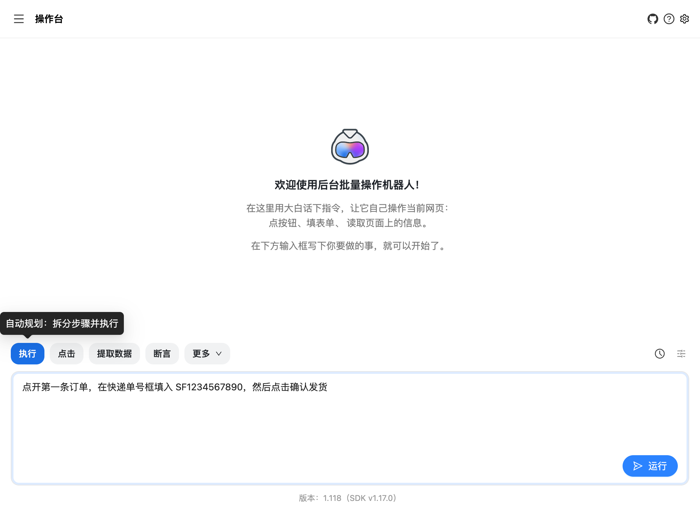

# 后台批量操作机器人（Midscene）

> 篝火出品 · 收录于篝火 App 应用区 · 基于开源项目 [web-infra-dev/midscene](https://github.com/web-infra-dev/midscene)（MIT）

用大白话告诉它要做什么，它看着屏幕自己点、自己填，把网页后台里的重复操作交给机器：比如逐条录入商品、逐页导出数据、批量检查状态。它靠“看截图”操作，不依赖页面源码，页面改版了也不用重写规则。

本仓库只提供 **Chrome / Edge 浏览器插件**，界面和说明全部是中文。

> 使用前提：需要你自己准备一个**支持图片识别的多模态大模型**（见下文），模型调用费用由你自己的账号承担。页面截图会发给你选择的模型服务商。



## 下载与安装

到 [Releases](https://github.com/campfire-code/backend-batch-bot/releases/latest) 下载 `backend-batch-bot_版本号_chrome-extension.zip`，附 `SHA256SUMS.txt` 可核对文件完整性。

插件没有上架应用商店，用“开发者模式”手动安装（手动安装的插件不会自动更新，新版本要重新下载）：

1. 把 zip 解压到一个固定文件夹，装好后不要删这个文件夹。
2. 浏览器地址栏打开 `chrome://extensions/`（Edge 是 `edge://extensions/`），打开右上角的“开发者模式”。
3. 点“加载已解压的扩展程序”，选择刚才解压的文件夹。
4. 点浏览器工具栏的拼图图标，把“后台批量操作机器人”固定出来；点它的图标，右侧会打开侧边栏。

## 先准备大模型

必须使用**多模态、能看图并定位界面元素**的模型。上游文档（`apps/site/docs/en/model-api-setup.mdx`）列出的可用模型系列如下，名称和 `MIDSCENE_MODEL_FAMILY` 要成对填写：

| 模型系列 | `MIDSCENE_MODEL_NAME` 示例 | `MIDSCENE_MODEL_FAMILY` |
|---|---|---|
| 通义千问 Qwen3.x | `qwen3.7-plus` | `qwen3` |
| 豆包 Seed 2.x | `doubao-seed-2-1-turbo-260628` | `doubao-seed` |
| 智谱 GLM-V | `glm-5v-turbo`、`glm-4.6v` | `glm-v` |
| DeepSeek V4 | `deepseek-flash` | `deepseek` |
| Kimi | `kimi-k2.5`、`kimi-k2.6` | `kimi` |
| Gemini 3.x | `gemini-3.5-flash` | `gemini` |
| OpenAI GPT-5 / GPT-6 | `gpt-5.5` | `gpt-5` / `gpt-6` |

以上名称按上游当前文档抄录，服务商改名下线后以上游文档和服务商控制台为准。完整列表与各家接口地址见上游的[模型配置文档](https://midscenejs.com/model-api-setup)。

配置一共四项（接口走 OpenAI 兼容格式）：

```ini
MIDSCENE_MODEL_BASE_URL="服务商的接口地址，例如 https://dashscope.aliyuncs.com/compatible-mode/v1"
MIDSCENE_MODEL_API_KEY="你自己的密钥"
MIDSCENE_MODEL_NAME="qwen3.7-plus"
MIDSCENE_MODEL_FAMILY="qwen3"
```

- 通义千问的接口地址是 `https://dashscope.aliyuncs.com/compatible-mode/v1`；豆包（火山引擎）是 `https://ark.cn-beijing.volces.com/api/v3`，其他服务商查各自文档。
- 密钥只保存在你自己的电脑里，不要发给别人，也不要写进公开的仓库。
- DeepSeek-V4-Pro 不支持图片输入，不能用。

## 怎么用

1. 点侧边栏右上角的设置图标，在“模型环境配置”里把上面四行配置整段粘贴进去保存。
2. 打开你要操作的网页后台，并保持该页面在前台可见。
3. 在侧边栏的操作台里输入一句话，例如“点开第一条订单，把状态改成已发货”，运行并查看结果。
4. 想检查结果，用“断言”（例如“列表第一行状态是已发货”）；想把页面数据读出来，用“提取数据”，结果以 JSON 返回。

侧边栏左上角的菜单里还有两个模式：

- **录制器（预览版）**：手动操作一遍网页，插件把你的点击和输入录下来，再生成 YAML 脚本或 Playwright 代码。
- **桥接模式**：让本机终端里运行的 Midscene SDK 控制这个浏览器，适合脚本和手动配合，或复用已经登录的 Cookie。

**安全提醒**：批量改动数据前，先在测试数据或单条订单上跑通；机器按屏幕内容点击，模型偶尔会点错，不要一次对大批量真实数据直接运行。

## 进阶：用 YAML 脚本批量跑（上游命令行工具）

插件之外，也可以把要重复的步骤写成脚本文件，用上游命令行工具跑（该工具不在本仓库发布包里，从 npm 安装）（需要 Node.js 20.19+、22.12+ 或 24+）。下面示例中所有字段（`web`、`tasks`、`flow`、`ai`、`aiInput`、`aiTap`、`aiWaitFor`、`aiQuery`、`aiAssert`、`name`、`sleep`）均来自上游 YAML 文档：

```yaml
# order-ship.yaml：在自家后台给两笔订单填写快递单号并确认发货
web:
  url: https://你家后台的地址/orders
  # 后台需要登录时，先在同一个浏览器里手动登录，或在第一个任务里用 ai 步骤登录

tasks:
  - name: 第一单发货
    flow:
      - ai: 点开订单号为 A1001 的订单详情
      - aiInput: 快递单号输入框
        value: SF0000000001
      - aiTap: 确认发货按钮
      - aiWaitFor: 页面提示发货成功
      - aiAssert: 订单状态显示为已发货

  - name: 第二单发货
    flow:
      - ai: 返回订单列表，点开订单号为 A1002 的订单详情
      - aiInput: 快递单号输入框
        value: SF0000000002
      - aiTap: 确认发货按钮
      - aiWaitFor: 页面提示发货成功

  - name: 导出当前列表
    flow:
      - aiQuery: 订单列表每一行的订单号和状态，返回 {orderNo: string, status: string}[]
        name: orders
```

运行：

```bash
npm i -g @midscene/cli
# 在当前目录新建 .env，写入上面四行模型配置（不要加 export）
midscene ./order-ship.yaml
```

运行结束会生成可视化报告，能逐步回放每一步的截图。YAML 脚本本身没有循环语法，订单多时请用程序生成多个 task，或改用上游的 JavaScript SDK（见上游文档 Integrate with Playwright / Puppeteer）。

**安全提醒**：批量改动数据前，先在测试数据或单条订单上跑通；脚本会按屏幕内容点击，模型偶尔会点错，不要直接对大批量真实订单一次跑完。

## 验收用例

| 操作 | 应得到 |
|---|---|
| 安装插件，粘贴模型配置，打开上游示例页 [TodoMVC](https://todomvc.com/examples/react/dist/#/)，在操作台输入“添加一条名为‘买牛奶’的待办并标记完成” | 页面出现该待办且被勾选 |
| 同页选“断言”，输入“列表里有‘买牛奶’，且已完成” | 断言通过 |
| 命令行 `pnpm dlx @midscene/test@latest model verify`（带上 `.env`） | 各项检查显示 PASS，确认模型可用 |

## 和上游的区别

- 把 Chrome 插件（`apps/chrome-extension`）及它用到的共用界面包（`packages/visualizer`、`packages/recorder`）的界面文字、插件名称和主要报错汉化为中文；功能逻辑与上游一致。
- 只发布插件 zip，由篝火的发布流程（`.github/workflows/release.yml`）从源码构建。上游的桌面版不在本仓库提供。
- 移除了上游用于编译、签名的工作流，这些依赖上游的密钥。
- 部分来自底层库的少量报错仍是英文，详见上游文档。

## 归属与许可证

本仓库由**篝火**整理发布，是篝火 App 应用区收录的开源工具之一。软件全部功能与版权归 [web-infra-dev/midscene](https://github.com/web-infra-dev/midscene) 原作者所有，按 MIT 许可证再分发（见 `LICENSE`）。全部工具目录见 [toolkit-hub](https://github.com/campfire-code/toolkit-hub)。

### 上游致谢（译自上游 README）

上游 Midscene.js 感谢以下项目：

- [Rsbuild](https://github.com/web-infra-dev/rsbuild) 和 [Rslib](https://github.com/web-infra-dev/rslib)：构建工具。
- [UI-TARS](https://github.com/bytedance/ui-tars)：开源智能体模型 UI-TARS。
- [Qwen-VL](https://github.com/QwenLM/Qwen-VL)：开源多模态模型 Qwen-VL。
- [scrcpy](https://github.com/Genymobile/scrcpy) 和 [yume-chan](https://github.com/yume-chan)：浏览器端控制安卓设备。
- [appium-adb](https://github.com/appium/appium-adb)：ADB 的 JavaScript 桥接。
- [appium-webdriveragent](https://github.com/appium/WebDriverAgent)：用 JavaScript 控制 XCTest。
- [YADB](https://github.com/ysbing/YADB)：提升文本输入性能。
- [libnut-core](https://github.com/nut-tree/libnut-core)：跨平台原生键鼠控制。
- [Puppeteer](https://github.com/puppeteer/puppeteer)：浏览器自动化与控制。
- [Playwright](https://github.com/microsoft/playwright)：浏览器自动化、控制与测试。

### 许可证

Midscene.js 按 [MIT 许可证](https://github.com/web-infra-dev/midscene/blob/main/LICENSE) 授权。
